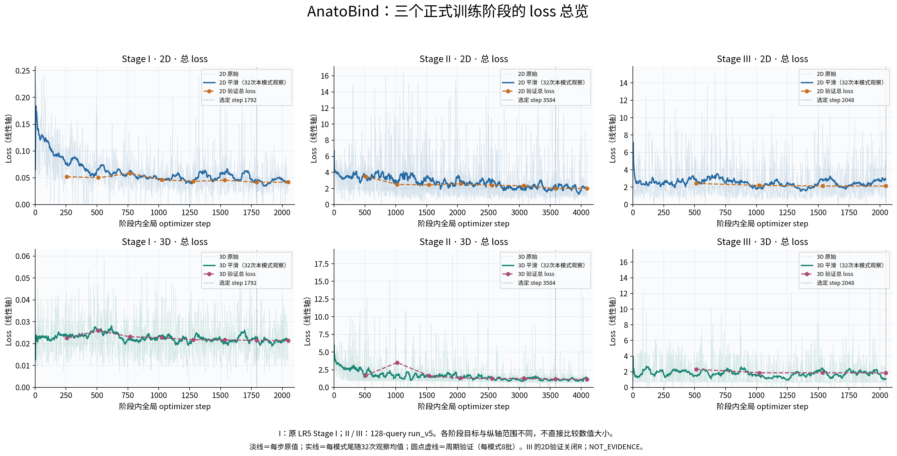

# Foundation_Model：训练完成与 A/U/R 评价说明

日期：2026-10-29。所有工程结果标记 `NOT_EVIDENCE`，不构成临床证据。本文件记录实际训练完成和下一步评价含义，不声称已执行最终评价。

## 当前进度

目标仍为同一个 checkpoint 独立支持2D/3D MRI，输出解剖A32、异常U128和异常宿主R。扫描protocol暂不显式输入，DICOM几何处理保留，论文工作暂缓。

- Stage I：LR5完成2048步，选定1792，通过双模式G1。
- Stage II：run_v5完成4096步，两模式各2048次曝光，选定3584。
- Stage III：完成2048步，两模式各1024次曝光，选定2048。
- 两阶段训练记录loss全部有限；控制器终态COMPLETE，完成证书核验和closing完整性通过。本次重新核对导出与完成文件哈希；见[匿名记录](completion_anonymous.json)。
- 完成终态文件更新于2026-10-28约21:59（北京时间）。训练步数完成不等于充分收敛或A/U/R质量达标。

## 实际loss曲线

使用原LR5 Stage I和128-query run_v5 II/III日志。淡线是原始值；实线为每模式尾随32次观察算术均值，起始窗口使用已有点；圆点虚线为周期验证，每模式8批。各阶段及面板纵轴独立。分项验证日志未保存，不能补造。

- [Stage I 重建loss](figures/01_stage_I_loss.png)
- [Stage II A/U/S分项](figures/02_stage_II_loss.png)
- [Stage III A/U/S/R分项](figures/03_stage_III_loss.png)
- [日志哈希与绘图口径](loss_provenance.json)

I二维loss明显下降，三维较稳定；II整体下降后放缓；III波动较大。只能描述优化趋势，不能凭平台期确认充分收敛。III的二维周期验证不含R；R无合格监督的步记0，平滑线包含这些零，不代表关系正确。III实际有R监督的步数为2D205、3D298。a_mask/u_mask是组合项，未单独保存内部BCE/Dice曲线。

## A：解剖结构分割

逐类Dice衡量预测与参照的重叠：Dice = 2×交集大小 /（预测大小＋参照大小）。例如预测与参照各100体素、重合80，Dice为0.80；这是解释用例，不是模型测量值。

报告32类各自Dice、逐类存在率，以及13个宿主的平均和最差Dice，防止均值掩盖整类缺失。当前参照是合格SynthSeg伪标签，不是医生精标。2D只评价该层符合可见性条件的结构。生产A使用原始mask概率解码，presence单独报告，不混入旧presence×mask诊断。

## U：检出、误报和轮廓

- 病灶检出率/灵敏度：匹配到的参照病灶数除以参照病灶总数。
- 误报：未匹配预测实例数，3D按FP/scan、2D按FP/image分别报告。
- 掩膜Dice：匹配实例的空间重叠，避免仅靠大面积覆盖而获得检出。

登记协议的一对一检出匹配条件为框IoU≥0.1，另加掩膜质量约束。U标签来自登记来源的人工病灶掩膜；S7提供同网格工作点参照和误报预算，不把S7输出写成人工真值。三个来源分别报告，其他未标注病种不在声明范围。

## R：异常所属结构

对实际检出的合格匹配病灶，计算宿主预测与几何伪参照一致的比例；不使用真值病灶代替预测病灶作为最终输入。参照含糊或未知的实例排除并报数，未知不等于no-host。2D按层内关系评价。

R的分母是合格且匹配上的实例，因此高R一致率不能掩盖U漏检。必须与U灵敏度一起解释。部署使用关系头还是查表，由development validation选择后冻结；不要求关系头一定胜过查表。

## 下一步（未执行）

1. 在development validation分别报告2D/3D的A逐类Dice、U灵敏度/误报/掩膜Dice、R宿主一致率，并检查真实预测叠加图。
2. 按既有规格选择并冻结三个来源的阈值及head/lookup实现；不看test后调阈值。
3. 构建合格historical_test后继角色，只做登记的最终评价；历史test已暴露，不宣称新独立队列。
4. 按冻结配置执行4469个fastMRI序列；缺方向字段时保持geometry=assumed、只报告屏幕侧别。

当前128-query真实CUDA恢复尚未单独验证；历史64恢复和CPU合成检查不能替代。最终六项质量门及全量fastMRI仍未完成。本次仅归档已有内容，不启动训练、推理或新评价。

验收数值与规则以[已批准规格](../../../superpowers/specs/2026-10-22-aur-three-subgoal-acceptance-design.md)为准，本说明没有修改阈值。
